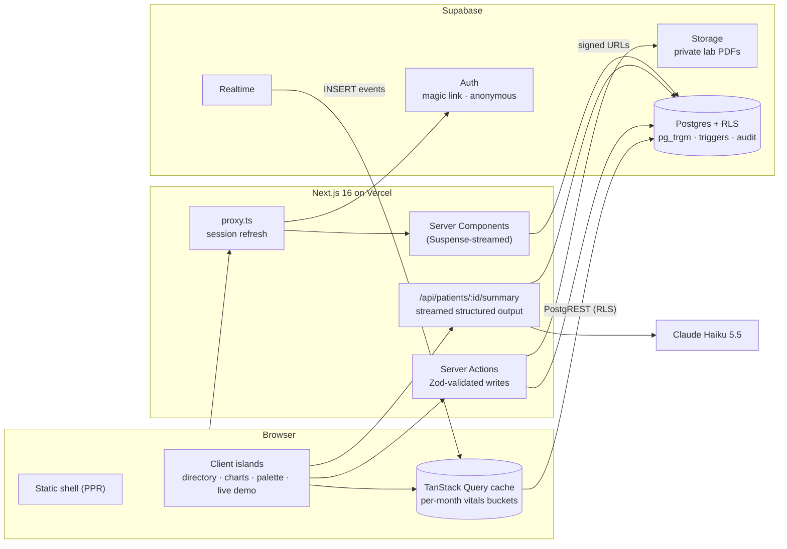

# Vitalis

**Clinical insights for clinicians.** Vitalis shows a clinician's patient panel ranked by risk, with 24 months of vitals, diagnoses, labs and a streamed AI summary. The signature patient header puts identity, a live risk score and a sparkline for every vital in one view.

> All data is synthetic, generated by a seeded script. Nothing here is medical advice.

**Stack:** Next.js 16 (App Router, React Server Components, Server Actions, partial prerendering) · React 19 · TypeScript (strict) · Tailwind CSS 4 · Radix/shadcn-style primitives · Supabase (Postgres, Auth, RLS, Realtime, Storage) · TanStack Query · nuqs · Zod · visx · Claude Haiku 5.5 · Vitest · Playwright · axe-core · GitHub Actions · Vercel

---

## Screenshots

| Patient overview (signature header) | Vitals analytics | Directory |
|---|---|---|
|  |  |  |

<sub>To regenerate: `npm run dev`, sign in as `demo@vitalis.test`, and capture at 1440×900 in light and dark themes.</sub>

---

## Features

| | |
|---|---|
| **Auth and roles** | Email magic link or one-click guest session. Clinicians see only assigned patients, enforced by Postgres RLS and proven by pgTAP tests. Views, downloads, status changes and AI calls are written to an append-only audit log. |
| **Patient directory** | Debounced name/MRN search (trigram-indexed), risk, condition and age filters, four sort orders, a window-virtualised list, and URL-synced state, so every view can be bookmarked. Server-prefetched and hydrated, so there's no loading flash. |
| **Patient overview** | The Vital Strip header (profile, live risk ring with factor breakdown, five vital tiles with 90-day sparklines, status and trend), contact and insurance details, and a merged activity timeline. |
| **Vitals analytics** | BP, HR, RR, temperature and SpO₂ over 3, 6 or 12 months or a custom range. Reference bands, critical thresholds, out-of-range markers, trend indicators and a previous-period overlay. Every chart has a keyboard cursor and a data-table view. |
| **Live demo** | Simulated check-ins stream through Supabase Realtime into the query cache, so tiles, risk ring and charts update in place. |
| **Diagnoses** | Status filters, per-diagnosis history, and optimistic status changes (row, history and audit written in one transaction). |
| **Lab results** | Result tables, plus server-generated PDFs that preview in-app and download through short-lived signed URLs. |
| **AI clinical summary** | Structured, Zod-validated output streamed from Claude Haiku 5.5, with a deterministic fallback, rate limits and clear "demonstration only" labelling. |
| **Command palette** | ⌘K / Ctrl+K: patient search, recently viewed patients, navigation and per-patient actions. |
| **Resilience** | Every view has a skeleton that matches its layout (no CLS), an error boundary with retry, and an empty state. |

---

## Architecture



**Principles**

- **The database is the security boundary.** Every query runs as the signed-in clinician. The service-role key is used only by the seed script and CI. No secret is ever prefixed `NEXT_PUBLIC_`.
- **Server first.** Pages are a static shell plus streamed Suspense boundaries. Client components appear only where there is interaction.
- **One source of truth per concern.** Zod schemas define every API contract. A single TypeScript risk model is shared by seed and UI. One nuqs parser set covers both server and client URL state.

Decisions are recorded in [`docs/decisions/`](docs/decisions):

- [State management](docs/decisions/0001-state-management.md)
- [Charting library](docs/decisions/0002-charting-library.md)
- [Data model and RLS](docs/decisions/0003-data-model.md)
- [AI integration](docs/decisions/0004-ai-integration.md)

### Project structure

```
src/
  app/                    routes only: layouts, pages, loading/error boundaries, route handlers
    (auth)/sign-in        public
    (app)/patients/[id]   overview · vitals · diagnoses · labs
    api/patients/[id]/summary
  features/               one folder per domain
    patients/  vitals/  diagnoses/  labs/  ai-summary/  realtime-demo/  command-palette/  audit/  auth/
      components/  hooks/  lib/ (pure, unit-tested)  server/ (queries, actions)  schemas.ts
  components/ui           design-system primitives (Radix + tokens)
  styles/tokens.css       OKLCH design tokens, light and dark
  lib/                    env validation, Supabase clients, formatting
supabase/migrations       schema, RLS, functions, triggers, storage, realtime
supabase/tests            pgTAP RLS tests
scripts/seed              deterministic synthetic data and PDF generation
tests/e2e                 Playwright: auth, search, ranges, AI, a11y, mobile, bundle budget
```

---

## Design system

- **Mood:** calm, clinical, premium. Neutral graphite surfaces with one confident accent, **Iris** (`oklch(0.51 0.21 277)`).
- **Clinical colour is reserved for meaning.** Normal, elevated and critical always come with an icon or label. A unit test parses `tokens.css` and checks WCAG AA for every text/background pair in both themes.
- **Type:** Inter (variable, self-hosted by `next/font`) on a 1.2 scale in `rem`. All numbers use tabular figures (`.num`).
- **Layout:** collapsible sidebar (its state is applied before first paint, so there's no shift) and a 12-column content grid. Designed mobile-first from 360 px, with scroll-snapping vital tiles.
- **Motion:** 120 and 200 ms with a soft ease-out, used only for state changes. Removed entirely under `prefers-reduced-motion`.

---

## Getting started

**Prerequisites:** Node 22+, Docker (for the local Supabase stack).

```bash
npm install
npm run db:start                    # starts Postgres, Auth, Realtime, Storage, Mailpit
cp .env.example .env.local          # then paste the URL and keys printed by db:start
npm run db:reset                    # applies migrations and seeds 50 synthetic patients
npm run dev                         # http://localhost:3000
```

**Sign in** as `demo@vitalis.test` (all 50 patients). The magic link arrives in Mailpit at <http://127.0.0.1:54324>. Or choose **Explore as a guest clinician** for a private panel of 30.

### Environment variables

| Variable | Where | Purpose |
|---|---|---|
| `NEXT_PUBLIC_SUPABASE_URL` | public | Supabase API URL |
| `NEXT_PUBLIC_SUPABASE_PUBLISHABLE_KEY` | public | Publishable (anon) key. Safe in the browser because RLS enforces access |
| `NEXT_PUBLIC_SITE_URL` | public | Base URL for magic-link redirects |
| `SUPABASE_SERVICE_ROLE_KEY` | server | Seed script and CI only. Never used by the running app |
| `ANTHROPIC_API_KEY` | server | Optional. Without it, summaries use the rule-based fallback |
| `AI_SUMMARY_MODEL` | server | Defaults to `claude-haiku-5-5` |
| `AI_SUMMARY_HOURLY_LIMIT` | server | Per-clinician summaries per hour (default 20) |
| `DEMO_SIMULATION_ENABLED` | server | Turns the live demo on or off (default `true`) |

Every variable is validated with Zod at startup (`src/lib/env.ts`, `src/lib/env.public.ts`).

### Scripts

| Script | Does |
|---|---|
| `npm run dev` / `build` / `start` | Next.js |
| `npm run typecheck` | `tsc --noEmit` (strict) |
| `npm run lint` | ESLint with `--max-warnings=0` |
| `npm test` | Vitest unit and component tests |
| `npm run test:e2e` | Playwright (starts the dev server) |
| `npm run db:start` / `db:stop` | Local Supabase: only the services Vitalis needs (`db:start:full` adds Studio) |
| `npm run db:reset` | Re-apply migrations and reseed |
| `npm run db:seed -- --patients=500 --skip-pdfs` | Seed at scale |
| `npm run db:test` | pgTAP RLS tests |
| `npm run db:types` | Regenerate `database.types.ts` |

---

## Testing

- **Unit:** clinical classification, ranges and month buckets, trends, downsampling, the risk model, snapshot building, timeline merging, directory query sanitisation, the AI digest (including a check that no identifiers are sent) and the rule-based summary, simulation, formatting, contrast of every design token pair, and seed-data invariants against the schema's check constraints.
- **Hooks:** `useDebouncedValue`, and `useVitalsRange`, which asserts that switching 12m → 3m → 6m triggers zero new fetches.
- **Database:** pgTAP proves patient isolation, simulated-only writes, audit immutability and per-author audit visibility.
- **End-to-end (Playwright):** real magic-link sign-in via Mailpit, search under 100 ms with URL sync, range switching without refetches, keyboard chart exploration and data tables, the AI summary flow, PDF preview, the command palette, mobile navigation with no horizontal scroll, axe-core WCAG 2.2 AA scans and a clean console.
- **Budget:** a Playwright check fails CI if `/patients` ships 200 KB or more of compressed JavaScript on first load.

## CI/CD

The [GitHub Actions workflow](.github/workflows/ci.yml) runs typecheck, lint (zero warnings), unit tests and a production build. A second job starts Supabase, runs the pgTAP tests, seeds the database, and runs Playwright against `next start`. Any error, warning or failing check fails the build.

**Deploy (Vercel and Supabase):**

1. Create a Supabase project, then run `npx supabase link` and `npx supabase db push`.
2. In Supabase Auth, enable email and anonymous sign-ins and add `https://<your-domain>/auth/callback` to the redirect URLs.
3. Seed once from your machine with the project's URL and service-role key in `.env.local`: `npm run db:seed`.
4. Import the repo in Vercel and set the public variables plus `ANTHROPIC_API_KEY` and `NEXT_PUBLIC_SITE_URL`. Never add the service-role key to Vercel.

---

## Origins

Vitalis started as a rethink of a vanilla-JS dashboard skills test I'd built earlier (a single patient and a Chart.js canvas). The patient-first information architecture carried over: list → vitals history → diagnoses → profile → labs. Everything else is new: brand, layout, data model and code. Specific fixes to that earlier build:

- The browser held credentials; now access is enforced by RLS.
- The canvas chart had no text alternative; now every chart is SVG with a text summary and a data table.
- Trend labels came pre-written from the API; now they're computed from clinical reference ranges.
- Icons looked clickable but weren't; now they're real buttons and links.
- There were no loading or error states; now every view has them.

## License

MIT
